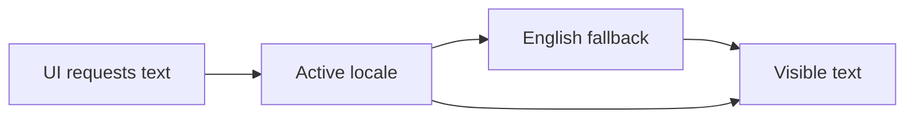

# Agent Instructions

## Scope and Role

- Act as a Principal Software Engineer. These rules apply to the whole repo.
- MUST follow the rules below for every frontend change.
- Use English for code names, comments, docs, and default UI text.
- Keep explanations short, direct, and free of icons or emojis.
- Inspect relevant files and call chains before drawing conclusions.
- Make small, focused changes. Avoid unrelated refactors, generic frameworks,
  factory patterns, and abstractions without a concrete need.
- Preserve user changes. Do not edit generated files or build output.
- Do not use GitNexus, write unit tests, or verify changes with screenshots.
- Use simple Mermaid diagrams when explaining flows or architecture. Keep each
  diagram small enough to understand in ten seconds.

## Project Stack and Structure

- React 19, TypeScript, Vite, and React Router.
- Tailwind CSS 4, CSS Modules, and shared shadcn/Base UI components.
- React Compiler is enabled. Oxlint and Prettier define lint and format rules.
- Use Bun for the scripts documented in this repo.
- Keep route pages in `src/pages`, layouts in `src/components/layouts`, route
  definitions in `src/components/routes`, and UI primitives in
  `src/components/ui`.
- Keep shared helpers in `src/lib`. Put feature logic near the feature that uses
  it. Use the existing `@/` import alias where it improves clarity.
- Reuse existing dependencies and components before adding new ones.

## TypeScript and Code Quality

- Use explicit types for props, API payloads, and shared function boundaries.
- Avoid `any`, unsafe casts, and non-null assertions. Narrow `unknown` values
  before use and validate external data at its boundary.
- Use `import type` for imports used only as types.
- Use clear names, small functions, guard clauses, and explicit `if`/`else` or
  `switch` branches. Extract complex conditions into named variables.
- Avoid nested ternaries and nested callbacks. Extract handlers into named
  functions when logic grows.
- Follow the existing Prettier settings: two spaces, single quotes, semicolons,
  trailing commas, and an 80-character print width.
- Do not silence lint or type errors to make a check pass. Fix their cause.

## React and State

- Use function components and follow the Rules of Hooks.
- Keep rendering pure. Never start requests or change state during render.
- Keep state near its owner. Derive values during render instead of storing
  duplicate state or syncing it through effects.
- Use effects only to sync with external systems. Include all dependencies and
  clean up listeners, timers, subscriptions, and pending requests.
- Use stable data IDs as list keys. Do not use array indexes for mutable lists.
- Treat props and state as immutable. Use functional updates when the next
  state depends on the previous state.
- Do not add `memo`, `useMemo`, or `useCallback` by default. With React Compiler
  enabled, add manual memoization only for a measured need or a required stable
  reference.
- Separate page orchestration from UI details when it makes the code easier to
  read. Avoid large components and deep prop chains.

## UI, Styling, and Accessibility

- Reuse shared UI primitives and theme tokens from `src/index.css`.
- Prefer Tailwind utilities or CSS Modules over large inline style objects.
  Use inline styles only for values that must be computed at runtime.
- Keep spacing, typography, colors, and interaction states consistent.
- Build responsive layouts. Check narrow and wide viewports, long content,
  browser zoom, and light/dark themes without screenshot capture.
- Use semantic HTML, links for navigation, and buttons for actions. Set button
  types explicitly.
- Give inputs visible labels. Connect help and error text with `aria-describedby`.
- Support keyboard use, visible focus, and correct dialog focus management.
  Prefer existing accessible primitives over custom controls.
- Give meaningful images alt text and decorative images empty alt text.
  Give icon-only controls a translated accessible name.
- Maintain readable contrast. Do not convey status by color alone. Respect
  reduced-motion preferences.
- Show clear loading, empty, error, success, and disabled states where relevant.
- Validate forms, prevent duplicate submissions, and retain input after failure.

## Routing, Data, and Security

- Use React Router for internal navigation and preserve existing route groups
  and layouts. Support direct URLs, unknown routes, and browser back/forward.
- Keep network logic separate from presentational components when adding APIs.
- Check HTTP status, handle failures, and cancel obsolete requests. Ensure stale
  responses cannot overwrite newer results.
- Bound large lists with server pagination where supported. Debounce costly
  searches when needed. Avoid duplicate requests and unbounded retries.
- Frontend route guards improve UX; the backend MUST enforce permissions.
- Never put secrets in frontend code or `VITE_*` variables; they are public.
- Follow the backend auth contract. Do not store session tokens in local storage.
- Render untrusted content as text. Avoid `dangerouslySetInnerHTML`; sanitize
  content with an established library if HTML rendering is required.
- Do not log credentials, tokens, or private user data. Show safe, translated
  errors rather than raw backend messages.

## Internationalization (Mandatory)

English (`en`) MUST be the default and fallback locale. New or changed UI MUST
be ready for translation. The repo currently has no i18n library; the paths and
examples below define the setup to add when implementing i18n.

- Use `i18next` with `react-i18next` for React translations. Initialize it once
  through `src/i18n/index.ts`, imported from `src/main.tsx` before rendering.
- Keep the English catalog in `src/i18n/locales/en.json`. Add other locale
  catalogs only when requested, using the same key structure.
- Use `useTranslation()` and `t()` for all user-facing text, including titles,
  labels, placeholders, tooltips, validation, notifications, and accessible names.
- Do not hardcode English or Vietnamese copy in new or changed components.
  Keep proper names and user-provided content unchanged.
- Use stable semantic keys such as `auth.login.title` and `common.actions.save`.
  Do not use English sentences as keys.
- Translate whole messages. Use named interpolation and locale-aware plurals;
  never join translated fragments or embed HTML in plain translation strings.
- Use `Trans` only when a message needs React elements, such as a link.
- Use `Intl.DateTimeFormat` and `Intl.NumberFormat` with the active locale.
  Specify currency and time zone when required by the data contract.
- Set `document.documentElement.lang` to the active locale and update it when
  the locale changes. Set `dir` correctly if an RTL locale is added.
- Respect a saved supported locale, then a supported browser locale, then `en`.
  Unsupported locales MUST fall back to English.
- Map known backend error codes to translation keys with a safe fallback.
- Keep catalogs in sync and check missing keys, interpolation, plurals, and long
  translations. Migrate existing copy in touched UI without unrelated rewrites.

Starter English catalog:

```json
{
  "common": {
    "actions": { "save": "Save", "cancel": "Cancel", "retry": "Try again" },
    "status": { "loading": "Loading..." },
    "errors": { "unexpected": "Something went wrong. Please try again." }
  },
  "auth": {
    "login": {
      "title": "Admin sign in",
      "continueWithGoogle": "Continue with Google",
      "processing": "Signing in..."
    }
  }
}
```



## Performance and Verification

- Measure before optimizing. Lazy-load large routes or assets when useful.
- Size images correctly, reserve their layout space, and lazy-load images below
  the fold. Keep dependencies and client bundles small.
- For code changes, run `bun run type-check`, `bun run lint`, and
  `bun run build`. Check formatting on changed files with
  `bunx --no-install prettier --check <changed-files>`.
- For docs-only changes, check formatting on the changed files.
- Verify changed behavior in the browser where available: keyboard use,
  navigation, form states, responsive layout, and locale behavior. Do not capture
  screenshots or claim checks that were not performed.
- Do not write unit tests. Run relevant existing checks and report any failure
  or check that could not run.
- Finish with a short account of what changed, what was verified, and any
  remaining limits.
