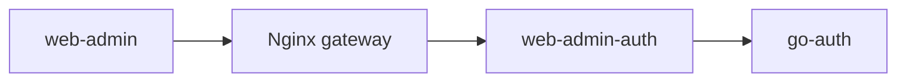

# web-admin

Technical admin console for an SMB technology product. The backend is the core:
contracts, security, data integrity, and operations come before product features.
The UI helps operators inspect and manage real backend resources. Build each
screen around a verified API; show actual data and clear failure states.



## Current state and target

React 19, TypeScript, Vite, React Router, Tailwind CSS 4, shared UI primitives,
and React Compiler. Bun runs project scripts. English is the default and
fallback locale through the existing i18next setup.

The admin console has been aligned with the simplified backend contract:
Users (with linked identities and direct roles), Identities, Roles (key/name),
Sessions (active/revocation), and Registrations (OAuth provider app metadata,
upsert, and enable/disable). Profile editing is implemented via `/a/profile`.
Unsupported groups, permissions, audit logs, and fake analytics have been removed.
See the [execution status](../go-auth/specs/2026-10-17-smb-auth-core/04-execution-status.md).

## Auth boundary

Browser API calls use same-origin `/api` routes. `web-admin-auth` handles Google
login, encrypted OAuth state, HttpOnly session cookies, and CSRF. The adapter
adds backend client credentials; the browser must never receive them or store
session tokens in local storage. Backend authorization is required even when a
route or action is hidden in the UI.

The standalone frontend Nginx image serves static files and SPA fallback only.
The [infra gateway](../infra/README.md) routes auth and admin requests to the
adapter, and provider callbacks to `go-auth`.

## Development and checks

```sh
bun install --frozen-lockfile
bun run dev
bun run type-check
bun run lint
bun run build
```

Run from this repository. Vite proxies `/api` and `/auth/callback` to
`VITE_PROXY_TARGET`, then `VITE_API_TARGET`, falling back to
`http://admin.anlew.local`. Point it at the gateway or cookie adapter, and
align origin and callback settings. `VITE_*` values are public.

Keep API types in `src/services`, routes in `src/components/routes`, pages in
`src/pages`, and translations in `src/i18n/locales/en.json`. Reuse theme tokens
and shared UI components. Check changed files with the installed Prettier.
Verify keyboard, loading, empty, error, denied, and mutation states without
screenshots. Do not add unit tests.

## Delivery

`bun run docker:build` builds the existing frontend image. Integrated delivery
uses the infra stack with `web-admin-auth` and `go-auth`; frontend Compose alone
does not provide authentication. Use immutable release tags for the planned
rollout; current infra manifests still use `latest`.

Agy owns phase breakdown and review; Claude implements assigned tasks. See the
[phase plan](../go-auth/specs/2026-10-17-smb-auth-core/02-delivery-phases.md)
and [orchestrator handoff](../go-auth/specs/2026-10-17-smb-auth-core/03-agy-orchestrator.md).
